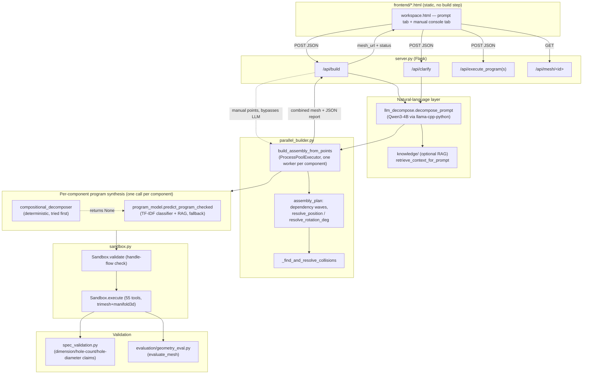
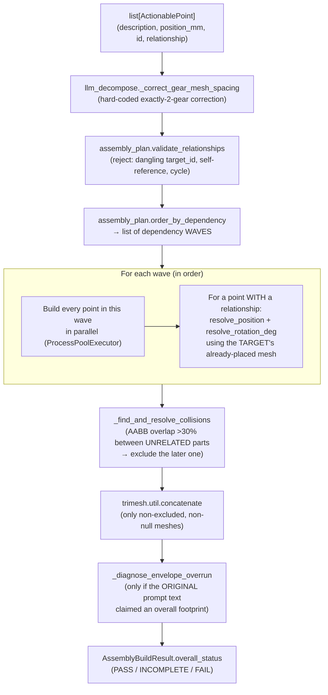

# KT.md — Engineering Knowledge Transfer for 3di-men

**Scope note, stated up front:** this repository contains three things that share a name or infrastructure but are not the same product:

1. **`ml/cad/`** — the actual, operational CAD-generation system. This document is about this one.
2. **`ml/threedimen/`** — a separate, broader "surface representation / teacher pipeline" project. Its own doc (`docs/threedimen-architecture.md`, line 4-7) says explicitly: *"This is a different, broader system than `ml/cad/`... `ml/cad/` stays exactly as it was; nothing here depends on it or replaces it."* Status: foundation implemented, no model trained. Not covered here.
3. **`docs/cad-finetuning-technical-report.md`** — an exploratory report about fine-tuning Hunyuan3D, written before any of `ml/cad/`'s current architecture existed. Historical context only, not current.

Everything below is about `ml/cad/`, verified directly against the checked-out code at commit `637e65a` (branch `main`). Every function/class reference was confirmed to exist at the stated path; nothing here is inferred from a prior conversation or from documentation alone.

**One correction to make before anything else:** `ml/cad/README.md` is stale. It documents a `python3 inference.py --prompt ...` CLI and a `benchmark.py`, both of which **no longer exist in this repository** (confirmed: `ls inference.py benchmark.py` → not found; `grep -rn "generate_from_prompt"` → zero matches anywhere in the codebase). The architecture it describes — "same parser, same generator, same two part families" — was replaced by the LLM-decomposition + proprietary-ML-tool-sequence architecture this document describes. `ml/cad/MISSION_STATUS.md` (line 9-13) independently confirms the architecture described here, and `evaluate.py` (a thin wrapper that still works, see §12) is the one piece of the old CLI still present. Do not follow `README.md`'s own Quickstart as written.

---

## Table of contents

1. [Understanding 3di-men](#1-understanding-3di-men)
2. [Repository tour](#2-repository-tour)
3. [System architecture](#3-system-architecture)
4. [The complete journey of a user prompt](#4-the-complete-journey-of-a-user-prompt)
5. [Prompt interpretation and AI/ML subsystem](#5-prompt-interpretation-and-aiml-subsystem)
6. [The CAD operation system](#6-the-cad-operation-system)
7. [Multi-part assembly architecture](#7-multi-part-assembly-architecture)
8. [Geometry validation and quality assurance](#8-geometry-validation-and-quality-assurance)
9. [Data structures and internal representations](#9-data-structures-and-internal-representations)
10. [API and frontend integration](#10-api-and-frontend-integration)
11. [Dependencies and environment](#11-dependencies-and-environment)
12. [Testing architecture](#12-testing-architecture)
13. [Debugging handbook](#13-debugging-handbook)
14. [Engineering decisions and trade-offs](#14-engineering-decisions-and-trade-offs)
15. [Glossary](#15-glossary)
16. [How I should extend 3di-men](#16-how-i-should-extend-3di-men)
17. [Current technical debt and limitations](#17-current-technical-debt-and-limitations)

---

## 1. Understanding 3di-men

### What it does, in one sentence

3di-men takes a plain-English description of a mechanical part or assembly and produces a real, watertight 3D mesh (STL/OBJ/GLB/3MF) by predicting a *sequence of parametric CAD operations* — not by generating a mesh directly, and not by matching the prompt to a pre-made template.

### What goes in, what comes out

- **In:** a natural-language prompt (`"a 100mm x 60mm x 10mm mounting plate with four 6mm through-holes near its corners"`), optionally with hand-edited answers to clarifying questions, or a hand-authored list of parts (the "manual playground" / "console" path).
- **Out:** a combined 3D mesh (served as `.stl`, convertible to `.glb`/`.obj`/`.3mf`), plus a structured JSON report: per-component build status, which tool-sequence was actually used, whether the built geometry's dimensions/hole-count/hole-diameter match what the text claimed, collision/footprint warnings, and one aggregate `overall_status` (`PASS`/`INCOMPLETE`/`FAIL`).

### Major subsystems (and where each one lives)

| Subsystem | Role | Entry file |
|---|---|---|
| Natural-language decomposition | Splits a prompt into independently-buildable component descriptions + spatial relationships | `llm_decompose.py` |
| Per-component program synthesis | Turns one component's description into a tool-call sequence | `compositional_decomposer.py` (deterministic) + `program_model.py` (statistical ML) |
| Geometry execution | Runs a tool-call sequence against a real mesh kernel | `sandbox.py` (`Sandbox.execute`) |
| Assembly orchestration | Builds every component, resolves relationships into world positions, combines meshes | `parallel_builder.py`, `assembly_plan.py` |
| Correctness-to-spec validation | Re-measures built geometry against the text's own numeric claims | `spec_validation.py`, `evaluation/geometry_eval.py` |
| Web API + frontend | HTTP surface + browser UI | `server.py`, `frontend/*.html` |

### What this system can and cannot do (verified, not aspirational)

**Can, confirmed by direct testing this session (see the Phase-7/Phase-8 audit history and the 20-prompt benchmark under `audit_results/`):**
- Build a wide range of individual mechanical shapes (boxes, cylinders, gears, stepped shafts, rings, shelled vessels, bracket-with-holes, etc.) via 55 real tools (§6).
- Decompose a multi-part assembly request into separate components with spatial relationships (face attachment, coaxial alignment, mirroring, parallel offset) — when the LLM decomposition succeeds.
- Re-measure a built part's own dimensions/hole count/hole diameter against what its description claimed, and disclose a mismatch rather than silently reporting success.
- Recover from some build failures via a narrow, bounded repair loop (`repair.py`).

**Cannot, confirmed by direct code reading, not assumption:**
- **Verify mechanical compatibility between two different components.** Nothing in this codebase checks "does this shaft actually fit this bore," "do these two gears actually mesh at the computed center distance in the *built* geometry," or "is this bearing's outer diameter compatible with its housing." `assembly_plan.py` only ever computes *where* a related part goes, never *whether* the resulting fit is correct. This is the single largest, most consequential gap found by this project's own 20-prompt audit (`audit_results/deterministic/`).
- **Verify that every requested component was actually built.** There is no component-inventory mechanism. A multi-part request that drops one component (e.g. a meshing gear's missing partner) can report a clean `PASS` — confirmed directly: see `audit_results/deterministic/E19.json`.
- **Detect a slot-shaped feature's own geometry** at all — `evaluation/geometry_eval.py`'s `GeometryReport` has hole detection (`detected_hole_count`, `hole_diameters_mm`, `hole_axes`, `hole_through`) but no equivalent slot field.
- **Reliably decompose a genuinely novel, free-form object** beyond a handful of well-known shapes (water bottle, cup) and composable mechanical patterns — `program_model.py`'s own module docstring (lines 31-44) states this honestly: it is "a TF-IDF + scikit-learn model trained on a few thousand mechanical-part examples, no LLM involved" for the *per-component* geometry step, and stays "confidently wrong" rather than abstaining on a wildly novel prompt.

### The six distinctions the mission brief asked for

| Distinction | What it actually means in this codebase |
|---|---|
| **Natural-language interpretation** | `llm_decompose.decompose_prompt` — the *only* place an LLM runs. Splits a prompt into component descriptions + relationships. Never produces geometry or tool calls itself. |
| **CAD program generation** | Turning ONE component's description into a `list[ToolCall]` — `compositional_decomposer.compose_program_from_description` (deterministic, narrow) or `program_model.predict_program_checked` (statistical, broad but approximate). |
| **Geometry generation** | `Sandbox.execute()` running that `list[ToolCall]` against `trimesh`+`manifold3d`, producing an actual mesh. |
| **Assembly construction** | `parallel_builder.build_assembly_from_points` + `assembly_plan.py` — placing each component's mesh into world space and combining them. |
| **Geometry validation** | `spec_validation.py` + `evaluation/geometry_eval.py` — does the *one* built mesh match its *own* description's claims. Per-component only. |
| **Mechanical correctness** | **Not implemented.** There is no "does component A actually fit/mesh/mate with component B" check anywhere in this codebase. This is the most important thing to understand about the system's current limits. |

---

## 2. Repository tour

```
3di-men/
├── KT.md                          ← this file
├── docs/                          ← historical/exploratory reports, NOT current ml/cad docs
└── ml/
    ├── threedimen/                ← separate, untrained foundation project (not covered here)
    └── cad/                       ← 3di-men itself (everything below is under here)
        ├── server.py              ← Flask app, the ONE HTTP entry point
        ├── llm_decompose.py       ← the ONLY file that loads an LLM
        ├── parallel_builder.py    ← assembly orchestration
        ├── assembly_plan.py       ← relationship → world-position math
        ├── compositional_decomposer.py  ← deterministic per-component program synthesis
        ├── program_model.py       ← statistical (scikit-learn) per-component program synthesis
        ├── sandbox.py             ← the 55-tool geometry kernel (Sandbox class)
        ├── repair.py              ← bounded, narrow auto-repair for a failed build
        ├── spec_validation.py     ← per-component correctness-to-spec checks
        ├── mesh_quality.py        ← post-CSG remeshing, collision/topology utilities
        ├── capability_registry.py ← tool metadata registry — NOT imported by any production file (dead code, see §17)
        ├── build_logger.py        ← append-only JSONL request log
        ├── printability.py        ← 3D-print analysis (Print Lab backend)
        ├── part_families.py       ← internal training-data scaffolding only (§2 table)
        ├── evaluate.py            ← thin CLI wrapper, still works, separate from /api/build
        ├── evaluation/
        │   └── geometry_eval.py   ← real-mesh feature detection (holes, cylinders, mirror symmetry)
        ├── data/                  ← synthetic training-data generation for program_model.py
        ├── knowledge/             ← optional RAG subsystem feeding llm_decompose.py
        ├── mitsugen/              ← a SIBLING product (3D printing), shares only infra — see §2 table
        ├── frontend/              ← static HTML/JS UI (no build step, no framework)
        ├── scripts/               ← training/eval/benchmark CLI entry points
        ├── training/              ← LoRA/QLoRA fine-tuning scaffolding, NOT wired to production
        ├── nlp/                   ← EMPTY — the old regex-based prompt parser was deleted here
        ├── models/                ← gitignored: the trained program_model.joblib + the Qwen3 .gguf
        ├── tests/                 ← 33 test files
        ├── audit_results/         ← this project's own benchmark/audit artifacts (not production)
        ├── audit_benchmark_*.py   ← this project's own audit tooling (not production)
        └── requirements.txt
```

### File responsibility table (production-path files only — see §2's own instruction not to cover every trivial utility)

| File | What it does | Called by | Calls | Production path? | When to modify it |
|---|---|---|---|---|---|
| `server.py` | Flask app; every HTTP route | Browser / `curl` | `llm_decompose`, `parallel_builder`, `sandbox`, `mitsugen.*`, `printability` | **Yes** — the one entry point | Adding a new API route |
| `llm_decompose.py` | Prompt → list of `ActionablePoint` (description + position/relationship) via the local Qwen3 LLM | `server.py`, `parallel_builder.py` | `llama_cpp`, `assembly_plan.Relationship`, `knowledge.pipeline` | **Yes** | Changing the decomposition system prompt, the JSON schema, or the LLM model |
| `parallel_builder.py` | Orchestrates building every component, resolving relationships, combining meshes, computing `overall_status` | `server.py` | `program_model`, `compositional_decomposer`, `sandbox`, `repair`, `spec_validation`, `assembly_plan`, `mesh_quality` | **Yes** — the core orchestrator | Changing build ordering, collision handling, or the PASS/FAIL/INCOMPLETE rule |
| `assembly_plan.py` | Deterministic math: relationship → world position + rotation | `parallel_builder.py` | `mesh_quality.find_facet_by_direction` | **Yes** | Adding a new relationship kind |
| `compositional_decomposer.py` | Deterministic, regex-pattern-matched description → tool-call program (tried FIRST, narrow coverage) | `parallel_builder._build_one` | `sandbox.ToolCall` | **Yes** | Adding a new recognized phrasing/pattern |
| `program_model.py` | Statistical (TF-IDF + scikit-learn) description → tool-call program (fallback, broad but approximate) | `parallel_builder._build_one` (via `predict_program_checked`) | `sandbox.ToolCall`, `data.program_dataset` (training only) | **Yes** | Retraining, changing the arbitration/threshold logic |
| `sandbox.py` | The actual mesh kernel: 55 tools (`Sandbox` methods), `validate()`, `execute()` | `program_model`, `compositional_decomposer`, `repair`, `server.py` (manual console), `parallel_builder` | `trimesh`, `manifold3d` (via trimesh), `evaluation.geometry_eval`, `mesh_quality` | **Yes** | Adding a new geometry tool |
| `repair.py` | Bounded retry (boolean operand swap, trailing-step truncation) on a non-`"ok"` build | `parallel_builder._build_one` | `sandbox.Sandbox.execute` | **Yes** | Adding a new safe repair strategy |
| `spec_validation.py` | Regex-extracted numeric claims vs. measured mesh dimensions/hole count/hole diameter | `parallel_builder.build_assembly_from_points` | — | **Yes** | Fixing a false-positive/negative in dimension checking |
| `evaluation/geometry_eval.py` | Real-mesh feature detection: holes, cylindrical patches, mirror symmetry | `sandbox.Sandbox.execute`, `spec_validation` (via the geometry report) | `trimesh`, `numpy` | **Yes** | Adding a new detectable feature (e.g. slots — currently absent, see §17) |
| `mesh_quality.py` | Post-CSG remeshing (`remesh_flat_facets`), collision AABB check, topology stats | `sandbox.py`, `parallel_builder.py`, `printability.py` | `trimesh` | **Yes** | Tuning the collision threshold, adding a new topology stat |
| `build_logger.py` | Appends one JSONL record per `/api/build` call to `logs/build_log.jsonl` | `server.py` | — | **Yes** (logging only) | Adding a new field to the build log |
| `capability_registry.py` | A hand-curated `ToolCapability` record per `sandbox.TOOL_OPS` entry | *(nothing — confirmed via `grep -rln capability_registry` outside tests)* | — | **No — not wired into any production path** | Only if you decide to actually wire it in (see §17) |
| `printability.py` | 3D-print feasibility analysis for Print Lab | `server.py` (`/api/print/*`), `mitsugen/pipeline.py` | `mesh_quality` | **Yes**, but a separate feature (Print Lab), not the CAD build path itself | Adding a new printability check |
| `part_families.py` | Typed registry of 6 "part family" param schemas | `data/program_dataset.py`, `data/prompt_dataset.py` (training-data generation only) | — | **No — internal training-corpus scaffolding only**, never imported by the live build pipeline | Only when changing how synthetic training data is generated |

---

## 3. System architecture



**Synchronous / asynchronous / deterministic / model-dependent, stage by stage:**

| Stage | Sync/async | Deterministic? | Model-dependent? |
|---|---|---|---|
| HTTP request handling (`server.py`) | Synchronous (Flask dev server, single request at a time by default) | — | — |
| Prompt decomposition (`llm_decompose.decompose_prompt`) | Synchronous, in-process (blocks the request) | **No** — real LLM inference | **Yes** — Qwen3-4B-Instruct, local, CPU by default |
| Per-component build | **Parallel across components** (`ProcessPoolExecutor`, `max_workers=4` default), but components with a relationship dependency are grouped into sequential *waves* (`assembly_plan.order_by_dependency`) | Mixed — `compositional_decomposer` is deterministic; `program_model` is a trained classifier (deterministic given a fixed model file, i.e. reproducible, but not rule-based) | `program_model.py` only (no LLM) |
| Geometry execution (`Sandbox.execute`) | Synchronous within its own worker process | **Yes** — plain geometric construction | No |
| Validation (`spec_validation.py`) | Synchronous | **Yes** — regex extraction + arithmetic comparison | No |
| Collision resolution | Synchronous, after all waves complete | **Yes** — a fixed AABB-overlap threshold | No |

### Assembly-generation architecture (separate diagram, as requested)



**What this diagram does NOT show, because it is not implemented:** any step that re-measures whether a relationship's own *mechanical* intent (a shaft fitting a bore, two gears meshing at the correct distance in the real built geometry) was actually satisfied. `resolve_position`/`resolve_rotation_deg` compute where a part goes; nothing downstream checks whether that was mechanically correct. See §7 for the full, verified explanation.

---

## 4. The complete journey of a user prompt

This section traces **exactly** what happens for:

> `"Create a 100 × 60 × 10 mm mounting plate with four 6 mm through-holes near its corners."`

sent through the *manual playground* path once (bypassing the LLM, since this exact phrasing is simple enough that it's also useful to show the non-LLM path), and the *prompt* path once (the real, full pipeline). Both paths converge at step 5.

### Step 1 — Where the request enters

**File:** `frontend/workspace.html`. The user types the prompt into the textarea bound to `promptEl` (prompt tab, `#promptTab`, line 437) and clicks the build button, which calls `runBuild(answers)` (line 1241).

```js
// frontend/workspace.html, line ~1251
const res = await fetch('/api/build', {
  method: 'POST',
  headers: { 'Content-Type': 'application/json' },
  body: JSON.stringify({ prompt, answers }),
});
```

### Step 2 — How the API receives it

**File:** `server.py`, `api_build()` (line 168).

```python
# server.py, line 168-198 (abridged)
@app.route("/api/build", methods=["POST"])
def api_build():
    body = request.get_json(silent=True) or {}
    manual_points = _parse_manual_points(body.get("points"))
    if manual_points:
        result = build_assembly_from_points(manual_points, DEFAULT_BUNDLE_PATH)
    else:
        prompt = body.get("prompt", "").strip()
        answers = body.get("answers") or []
        qa_pairs = [(a.get("question", ""), a.get("answer", "")) for a in answers if isinstance(a, dict)]
        enriched_prompt = fold_answers_into_prompt(prompt, qa_pairs)
        result = build_assembly_from_prompt(enriched_prompt, DEFAULT_BUNDLE_PATH)
```

- **Input:** raw JSON body `{"prompt": "...", "answers": [...]}`.
- **Output:** an `AssemblyBuildResult` (dataclass, `parallel_builder.py` line 147).
- **Decision:** `points` present → skip the LLM entirely (`build_assembly_from_points`, the manual/deterministic path). Otherwise → `build_assembly_from_prompt`, which calls the LLM.
- **Failure condition:** empty prompt → `400`. No trained bundle at `models/program_model.joblib` → `500` before any work starts.

### Step 3 — How the prompt is interpreted (the LLM path)

**File:** `llm_decompose.py`, `decompose_prompt()` (line 628), called from `parallel_builder.build_assembly_from_prompt` (line 787).

```python
# parallel_builder.py, line 787-796
def build_assembly_from_prompt(prompt: str, bundle_path: Path, max_workers: int = 4) -> AssemblyBuildResult:
    from spec_validation import extract_claimed_envelope_mm
    decomposition = decompose_prompt(prompt)
    claimed_envelope_mm = extract_claimed_envelope_mm(prompt)
    result = build_assembly_from_points(decomposition.points, bundle_path, max_workers, claimed_envelope_mm=claimed_envelope_mm)
    result.fell_back_to_single_point = decomposition.fell_back
    ...
```

Inside `decompose_prompt`: the Qwen3-4B model (loaded once, lazily, as a module-level singleton `_llm`, line 236) is called with a large (~7,000-token) system prompt (`_SYSTEM_PROMPT`, line 81) describing the exact JSON array shape to return, constrained by a **grammar** (`LlamaGrammar.from_json_schema`, line 326-328) built from `_POINTS_JSON_SCHEMA` (line 268) so malformed JSON is structurally impossible to emit. For our example prompt (a single plate, no relationships to another part), the LLM is expected to return:

```json
[{"id": "plate", "description": "a box 100mm x 60mm x 10mm with a corner array of four 6mm diameter holes, each 15mm from a corner", "position_mm": {"x": 0, "y": 0, "z": 0}}]
```

(This exact phrasing style — "a box LxWxH with a corner array of N holes, each Dmm from a corner" — is dictated by `_SYSTEM_PROMPT`'s STEP 3, line 109: *"describe EACH part using plain, dimension-first geometry language... Do NOT dress this up with engineering jargon."*)

- **Output data structure:** `DecomposeResult` (line 217-227): `points: list[ActionablePoint]`, `raw_llm_output`, `fell_back: bool`.
- **Failure condition:** if the model's output can't be parsed into that JSON shape (`_parse_points`, line 444, raises on empty/malformed output) — `decompose_prompt`'s own `try/except` (line 679-687) catches this and falls back to **one single `ActionablePoint`** wrapping the *entire original prompt text* as its description, with `fell_back=True`. **This is the only decomposition fallback that exists** — there is no deterministic decomposition path as a backup for the LLM itself (only for per-component geometry, next step). A SEPARATE, more severe failure mode — the local LLM's native library (`llama-cpp-python`) crashing the whole Python process — is **not caught by anything** in the current codebase; see §17.

### Step 4 — Identifying components, dimensions, and features

For our plate example there is only one component, so "identifying components" (step 4 of the mission brief's own list) and "component identification" (step 6) collapse into the single `ActionablePoint` above. For a genuinely multi-part request, this is where `_SYSTEM_PROMPT`'s STEP 1 (line 95) logic applies: the LLM is instructed to treat each physically-separate solid as its own array entry, and features (holes/slots/patterns) as part of the SAME entry as the solid they cut into — *never* their own entry. There is **no deterministic cross-check afterward that the decomposed list actually matches what the prompt asked for** — this is the "component completeness" gap documented in §1 and §7.

### Step 5 — How operations are selected (both paths converge here)

**File:** `parallel_builder.py`, `_build_one()` (line 257), run inside a worker process (one per component, via `ProcessPoolExecutor`).

```python
# parallel_builder.py, line 269-296 (abridged)
if program_override is not None:
    prediction = ...  # user-hand-edited program, skip prediction entirely
else:
    compositional_program = compose_program_from_description(description)
    if compositional_program is not None:
        prediction = ProgramPrediction(program=compositional_program, ...)
        resolution_method = "compositional"
    else:
        prediction = predict_program_checked(_worker_bundle, description)
        resolution_method = "statistical"
```

For `"a box 100mm x 60mm x 10mm with a corner array of four 6mm diameter holes, each 15mm from a corner"`, `compositional_decomposer.compose_program_from_description` (line 416) is tried **first**:

1. `_resolve_box` (one of `_BASE_RESOLVERS`, line 164) matches the leading `"a box 100mm x 60mm x 10mm"` clause → base shape `add_box`.
2. The text after `_WITH_RE`'s match (`"with"`) is handed to `_FEATURE_RESOLVERS` in priority order; `_feature_corner_array_holes` matches `"a corner array of four 6mm diameter holes, each 15mm from a corner"`.
3. Result: a deterministic `[ToolCall(op="add_box", args={...}), ToolCall(op="drill_hole_pattern", args={...}), ToolCall(op="finalize", ...)]` — **no ML model involved for this description.**

If the description had used phrasing *neither* resolver recognized, `compose_program_from_description` returns `None` and `program_model.predict_program_checked` (§5) takes over instead — the statistical path.

### Step 6 — How the CAD program is constructed

The result of step 5 is always a plain Python list of `sandbox.ToolCall(op: str, args: dict)` objects (`sandbox.py` line 115-118) — e.g.:

```python
[
    ToolCall(op="add_box", args={"length": 100.0, "width": 60.0, "height": 10.0, "center": [0,0,0]}),
    ToolCall(op="drill_hole_pattern", args={"target": 0, "pattern": "corner_array", "count": 4, "radius": 3.0, ...}),
    ToolCall(op="finalize", args={"target": 1}),
]
```

### Step 7 — How tools are executed

**File:** `sandbox.py`, `Sandbox.execute()` (line 2441), called via `repair.execute_with_bounded_repair` (line 170), which calls it at least once.

1. `Sandbox.validate(program)` (line 2402) first — a zero-geometry, pure-bookkeeping pass confirming every `target`/`a`/`b` handle reference points at a handle that was actually created and not yet consumed. **No mesh math runs if this fails** — the result is `status="rejected"` immediately.
2. A fresh `Sandbox(trace=False)` instance executes each `ToolCall` in order via `getattr(sb, call.op)(**call.args)` (line 2488-2489) — i.e., `sb.add_box(length=100.0, ...)`, then `sb.drill_hole_pattern(target=0, ...)`, then `sb.finalize(target=1)`.
3. After **every** step, the result is checked for an empty mesh and watertightness immediately (line 2492-2498) — not just at the end. This is what lets a mid-program failure still return the last good mesh (`status="partial"`) instead of nothing.

### Step 8 — How geometry is created

Each `add_*` tool method directly builds a `trimesh.Trimesh` using `trimesh.creation.*` primitives or `trimesh.boolean` operations (backed by `manifold3d`). For example, `add_box` is a thin wrapper around `trimesh.creation.box`; `drill_hole_pattern` computes N hole center positions from the *target's own already-built bounding box* (not a separately-predicted argument — see `sandbox.py`'s own module docstring, line 27-31) and runs a `boolean_difference` per hole.

### Step 9 — How repairs work

**File:** `repair.py`, `execute_with_bounded_repair()` (line 170). If `Sandbox.execute` doesn't return `"ok"`:

1. Try swapping the operands of the **last commutative boolean op** before the failure (`boolean_union`/`boolean_intersection` only — never `boolean_difference`, which is not commutative and would silently change *what* is being cut from what). This never changes requested dimensions or features.
2. If that doesn't fully fix it (or there's no boolean op to retry), fall back to **truncating trailing steps** and re-finalizing earlier (`_repair_by_truncation`, line 103) — bounded to 3 tries, never below 1 surviving step. This *can* drop a requested feature, but it is always disclosed (`RepairAttempt.description`, never silent).

For our clean plate example, no repair is needed — the box-and-hole-pattern program succeeds on the first try.

### Step 10 — How geometry is validated

Back in `parallel_builder.build_assembly_from_points` (line 354), after the worker returns:

```python
# parallel_builder.py, line 493-536 (abridged)
dim_report = validate_dimensions_against_description(point.description, own_mesh)
...
hole_report = validate_hole_count_against_description(point.description, raw.get("geometry_report"))
...
diameter_report = validate_hole_diameters_against_description(point.description, raw.get("geometry_report"))
```

For the plate: `extract_claimed_dimensions_mm` (`spec_validation.py` line 59) finds `[100.0, 60.0, 10.0]` in the text; these are compared against the built mesh's own extents/volume-derived characteristic length (`_measured_reference_lengths`, line 148) within a 15% tolerance. `extract_claimed_hole_count` finds `4`; `evaluation.geometry_eval.evaluate_mesh`'s `detected_hole_count` is compared against it exactly. If everything matches, `status` stays `"ok"`; if anything doesn't, `status` becomes `"suspect"` and the specific mismatch is recorded in `error`.

### Step 11 — How the result is returned

`AssemblyBuildResult.overall_status` (`parallel_builder.py` line 176) aggregates every point's status into one of `PASS`/`INCOMPLETE`/`FAIL` (exact rule in §8). `server.py`'s `api_build()` then exports the combined mesh (`_export_mesh`, line 36 — writes a UUID-named `.stl` to `webapp_output/`) and returns a JSON response (line 287-320) with `mesh_url`, per-point diagnostics, `collision_warnings`, `envelope_warnings`, and `overall_status`.

### Step 12 — How the frontend receives and displays it

**File:** `frontend/workspace.html`, `applyBuildResponse()` (line 1194), called from `runBuild`'s `await` on the fetch response.

```js
// frontend/workspace.html, line 1194-1203 (abridged)
async function applyBuildResponse(data) {
  setPartsFromBuildResult(data.points);
  renderAssemblyTopology(data.assembly_topology);
  renderCollisionWarnings(data.collision_warnings, data.envelope_warnings);
  renderOverallStatusBanner(data.overall_status);
  ...
  if (data.mesh_url) { await loadSTL(data.mesh_url); ... }
}
```

`loadSTL` (line 731) fetches the `.stl` via the `mesh_url`, parses it with three.js's `STLLoader`, and renders it in the WebGL viewer.

### Step 13 — How the user obtains the final output

The download link set in `applyBuildResponse` points at `/api/mesh/<mesh_id>` (`server.py` line 436), which serves the on-disk `.stl` directly, or lazily converts it to `.glb`/`.obj`/`.3mf` in memory if `?format=` is given (line 449-462) — the file on disk is always STL-only; other formats are produced on demand, never pre-generated.

### What happens when a stage fails (summary table)

| Stage | Failure | What happens |
|---|---|---|
| LLM decomposition | Malformed/unparseable output | Falls back to one `ActionablePoint` wrapping the whole prompt, `fell_back=True` — disclosed, not silent |
| LLM decomposition | Native crash in `llama-cpp-python` | **Takes the entire Flask process down.** Not caught anywhere in the current code (see §17). |
| Relationship resolution | Dangling `target_id`, self-reference, cycle | `assembly_plan.RelationshipError` raised *before* any geometry is built; every point in the assembly is reported `status="rejected"` |
| Tool execution | Bad handle reference | `Sandbox.validate()` catches it with zero geometry cost; `status="rejected"` |
| Tool execution | A step produces an empty/non-watertight mesh | Caught immediately at that step (not just at the end); `repair.py` attempts a bounded recovery |
| Validation | Built dimensions/hole-count/diameter don't match the text | `status` downgraded to `"suspect"`; build still completes, mismatch disclosed in `error` |
| Assembly | Two unrelated parts' bounding boxes overlap >30% | The later-placed one is excluded from the *combined* mesh (not from the response) — `excluded_from_assembly=True` |

---

## 5. Prompt interpretation and AI/ML subsystem

### LLM integration

**File:** `llm_decompose.py`. The *only* file in `ml/cad/` that imports an LLM (confirmed by its own module docstring, line 1: *"The ONLY file in this project that imports an LLM"* — `mitsugen/freeform.py` also loads one, but that's a sibling product, not this one, see §2).

- **Model:** `Qwen3-4B-Instruct-2507`, `Q4_K_M` quantized GGUF, loaded via `llama-cpp-python`'s `Llama` class — entirely local, no network call, no API key (line 8-17).
- **Model loading:** lazy, module-level singleton (`_llm`, line 236, `_get_llm`, line 239) — loaded once per process on first use, not once per request.
- **Model configuration:** every tunable is an environment variable with a documented default (`MODEL_NAME`, `MODEL_FORMAT`, `QUANTIZATION`, `MAX_CONTEXT=16384`, `TEMPERATURE=0.1`, `N_GPU_LAYERS=0`, `N_THREADS=None`), never hard-coded.
- **Prompt templates:** `_SYSTEM_PROMPT` (line 81, ~7,000 tokens) for decomposition; `_CLARIFY_SYSTEM_PROMPT` (line 167) for the optional clarify stage.
- **Grammar constraints:** yes — `LlamaGrammar.from_json_schema(_POINTS_JSON_SCHEMA)` (line 268-311, 328) forces every generated token to stay inside a syntactically valid instance of the points-array shape. This does not guarantee *semantic* correctness (a wrong description or a wrong relationship), only structural JSON validity.
- **Structured output:** a JSON array of `{id, description, position_mm, relationship?}` objects (the `ActionablePoint` shape).

### Component decomposition, classification, retrieval/RAG, arbitration — which belongs to which model

This is where it's easy to conflate two *separate* ML systems. There are two:

1. **`llm_decompose.py`'s LLM** — decides *how many components* exist and *how they relate spatially*. One call per `/api/build` request (not per component).
2. **`program_model.py`'s scikit-learn model** — decides *which tool sequence* builds ONE already-decomposed component's description, and *what numeric arguments* that sequence takes. One call per component, per build. **No LLM involved anywhere in this second system** — it is TF-IDF vectorization + per-slot `LogisticRegression` classifiers + per-argument `Ridge`/`LogisticRegression` regressors (`program_model.py` line 332-343, 369-382).

**Classification** (which op goes in which "slot"): `program_model.py`'s `K_SLOTS=10` unrolled-slot architecture (line 53, class docstring line 5-16). Each of the 10 slots has its own trained classifier predicting one op name, conditioned on the prompt's TF-IDF vector *plus* a one-hot summary of the ops already chosen in earlier slots (`_prior_slot_features`, line 287).

**Retrieval/RAG**: `retrieve_nearest_op_sequence` (line 695) finds the `k=5` nearest training examples by TF-IDF cosine similarity and returns their majority-vote op-sequence *shape* — always a real observed training sequence, never a hallucinated one.

**Arbitration**: `predict_program_hybrid` (line 747) runs *both* the per-slot classifier and the RAG retrieval independently, then:
- If they agree → use that (free confidence signal, no further check).
- If they disagree → RAG's sequence wins **only if** its retrieved neighbor's similarity clears `ProgramModelConfig.rag_override_similarity_threshold` (default `0.20`) — otherwise the classifier's own sequence is used. This exact threshold's own docstring (line 195-253) documents a real measured threshold sweep showing **no single value correctly separates "RAG helps" from "RAG hurts"** — a genuinely disclosed, unresolved limitation, not a bug waiting to be fixed by raising a number.

**Confidence/similarity thresholds**: `ood_similarity_threshold=0.20` (nearest-neighbor similarity below this → `in_distribution=False`, disclosed to the caller via `ProgramPrediction`, line 832-840) and `rag_override_similarity_threshold=0.20` (same value today, but a *separate* config field — see the "different risk profile" rationale in the docstring).

**Fallback behavior**: `predict_program` (line 605) *always* returns some program for any input text, including a wildly novel one ("a spaceship") — it never abstains. The honesty mechanism is `predict_program_checked`'s separate `in_distribution` flag, which tells a caller "I have no real support in training data for this," without changing *what* was predicted.

**Error handling**: `decompose_prompt` never raises (catches any parse failure, falls back to one point). `program_model.predict_program` never raises either — every slot's model always produces *some* op/args, even if a literal-number override later corrects the specific values.

### Which decisions are made by the LLM, and which by deterministic Python code

| Decision | Made by |
|---|---|
| How many physical components exist | LLM (`llm_decompose`) |
| How components relate spatially (face/coaxial/mirror/parallel) | LLM proposes a relationship *kind*; **deterministic Python** (`assembly_plan.resolve_position`/`resolve_rotation_deg`) computes the actual numeric position/rotation from the target's real built mesh — the LLM never computes coordinates for a relationship-based placement |
| Gear mesh center distance | **Deterministic Python** (`llm_decompose._correct_gear_mesh_spacing`, line 478) — the LLM's own rough guess is explicitly, unconditionally overridden by `module * (teethA + teethB) / 2` |
| Which tool builds a given shape | **Deterministic regex** (`compositional_decomposer`) when a known pattern matches; **scikit-learn classifier** otherwise |
| A shape's literal stated dimensions (e.g. "15mm tall") | **Deterministic regex override** (`program_model._override_primary_shape_dimensions`, line 424) — always wins over the trained regressor's own numeric prediction, when present |
| A shape's *unstated* dimensions | The trained `Ridge` regressor's own approximation (no literal number exists to override with) |

### A worked example: prompt → structured intermediate data

For `"A small gearbox: two spur gears meshing on parallel shafts, module 2.5mm, gear A has 14 teeth, gear B has 22 teeth, each gear is mounted on its own 10mm diameter, 60mm long shaft"` (one of `_SYSTEM_PROMPT`'s own worked Example 3, line 143), the LLM is documented to produce:

```json
[
  {"description": "a cylinder 10mm diameter, 60mm long", "position_mm": {"x": 0, "y": 0, "z": 0}},
  {"description": "a gear profile, module 2.5, 14 teeth", "position_mm": {"x": 0, "y": 0, "z": 0}},
  {"description": "a cylinder 10mm diameter, 60mm long", "position_mm": {"x": 40, "y": 0, "z": 0}},
  {"description": "a gear profile, module 2.5, 22 teeth", "position_mm": {"x": 40, "y": 0, "z": 0}}
]
```

`llm_decompose._correct_gear_mesh_spacing` then recognizes exactly 2 gear-profile points, computes `2.5 * (14 + 22) / 2 = 45mm`, and corrects the second shaft/gear's position to be exactly 45mm from the first — **the LLM's own rough `x=40` guess is never trusted for this number.**

### Why these particular models, and their limitations

From `program_model.py`'s own module docstring (line 1-44): a real seq2seq/transformer decoder was considered and *rejected*, not for training-speed reasons, but because (a) handle references must never point at an undefined/consumed step — a plain classifier over a *bounded, relative* offset ("N steps back") gets this for free, with no grammar-masking machinery needed; (b) precise numeric generation is not something a token-sampling decoder does well. The honest cost: this architecture's op-*choice* accuracy for the 6 original "part families" is easy almost by construction (fixed op-sequence shape per family); the real test is the much smaller, separately-tracked `generic_composition` eval bucket (`program_eval.py`), which is expected to — and does — score lower, and is never averaged with the family bucket.

---

## 6. The CAD operation system

### How an operation is selected and how its arguments reach the geometry generator

Already traced in full in §4 steps 5-8. In short: `compose_program_from_description` (deterministic) tried first, `predict_program_checked` (statistical) as fallback — either way the result is a `list[sandbox.ToolCall]`, which `Sandbox.execute` runs by calling `getattr(sandbox_instance, tool_call.op)(**tool_call.args)`.

### The important operations

*(55 total, defined as `Sandbox` methods in `sandbox.py`; `TOOL_OPS`, line 99-112, is the complete list exposed to the manual console. This table covers the ones most relevant to understanding typical builds — every op's full argument schema is in `program_model.ARG_SCHEMA`, line 57-145, which is reflected automatically, never hand-duplicated, by `sandbox.tool_schema()`, line 2557.)*

| Operation | Purpose | Key input parameters | Geometry produced | Implementation |
|---|---|---|---|---|
| `add_box` | Rectangular box | `length, width, height, center` | A box, exact by construction | `sandbox.py` line 464 |
| `add_cylinder` | Cylinder | `radius, height, center, axis` | A cylinder | `sandbox.py` line 472 |
| `add_shouldered_cylinder` | A two-diameter stepped shaft, built as ONE primitive | `bottom_radius, bottom_height, top_radius, top_height, transition_height, center` | A stepped/shouldered cylinder | `sandbox.py` line 547 |
| `add_gear_profile` | An involute spur gear | `module_mm, tooth_count, face_width_mm, bore_diameter_mm, pressure_angle_deg, center` | A real gear profile (a macro, not decomposed further — see §14) | `sandbox.py` line 2371 |
| `add_ring` | A flat washer/ring | `outer_radius, inner_radius, height, center, axis` | An annulus | `sandbox.py` line 995 |
| `add_tube` | A solid/hollow tube along a straight, arced, or helical path | `outer_radius, inner_radius, path_kind, path_param_*` | A swept tube | `sandbox.py` line 788 |
| `boolean_union` / `boolean_difference` / `boolean_intersection` | Combine two shapes | `a, b` (consumed handles) | CSG result via `trimesh`/`manifold3d` | `sandbox.py` line 1144-1176 |
| `drill_hole` | A single round hole | `target, radius, depth, center, axis` | A through or blind cylindrical cut | `sandbox.py` line 1225 |
| `drill_hole_pattern` | A pattern of holes (corner array / bolt circle / linear row) | `target, pattern, count, radius, depth, axis, margin, circle_diameter, z` | N holes, positions derived from the TARGET's own built bounds, not predicted separately | `sandbox.py` line 1239 |
| `drill_slot` | One elongated, rounded-end mounting slot | `target, direction, offset_u, offset_v, radius, slot_length, slot_axis, depth` | A stadium-shaped cut | `sandbox.py` line 1517 |
| `counterbore_hole` | A fastener clearance hole with a recessed head pocket | `target, direction, hole_radius, head_radius, head_depth, head_style` | Flat-bottomed (socket-head) or conical (flat-head) counterbore | `sandbox.py` line 1450 |
| `shell` | Hollow out a shape, leaving a wall thickness | `target, wall_thickness` | A shelled solid | `sandbox.py` line 1847 |
| `fillet_edge` / `chamfer_edge` | Round/bevel ONE named edge where two faces meet | `target, direction1, direction2, radius`/`distance` | A locally-rounded/chamfered edge | `sandbox.py` line 2055, 2139 |
| `round_box_edges` / `chamfer_box_edges` | Round/chamfer EVERY edge of a box-like shape at once | `target, radius`/`distance` | All-edges-treated box | `sandbox.py` line 2249, 2259 |
| `taper` / `flare` | Narrow/widen one end along an axis, straight or curved | `target, axis, bottom_factor, top_factor` | A tapered/flared shape | `sandbox.py` line 1014, 1043 |
| `add_boss_with_bore` | A raised cylindrical boss with an axial hole, on a named face | `target, direction, boss_radius, boss_height, bore_radius` | A boss + through-bore | `sandbox.py` line 2294 |
| `finalize` | Marks the program's own final, exportable mesh | `target` | — (returns the actual `trimesh.Trimesh`, not a handle) | `sandbox.py` line 2394 |

### Geometry libraries and representations

- **`trimesh`** — the mesh representation (`trimesh.Trimesh`) used *everywhere* in this codebase; every tool returns an integer *handle* into a per-`Sandbox`-instance dict of `trimesh.Trimesh` objects (`sb._shapes`), not the mesh itself, until `finalize`.
- **`manifold3d`** — the actual CSG (boolean) kernel, used internally by `trimesh.boolean.*`, never called directly by this project's own code.
- **`numpy`** — all vector/matrix math (transforms, bounds, face normals).
- **`shapely`** — 2D polygon operations, used for 2D-profile-based tools (extrusions, lofts, sweeps) before they're extruded into 3D.

### CAD program vs. mesh vs. final exported model

| Concept | What it is | Example |
|---|---|---|
| **CAD program** | A `list[sandbox.ToolCall]` — a *recipe*, no geometry computed yet | `[ToolCall("add_box", {...}), ToolCall("drill_hole", {...}), ToolCall("finalize", {...})]` |
| **Mesh** | The actual `trimesh.Trimesh` object produced by running that recipe — vertices, faces, in memory | What `Sandbox.execute().mesh` holds |
| **Final exported model** | The mesh serialized to a file format and written to disk/sent over HTTP | `webapp_output/<uuid>.stl`, or a `.glb`/`.obj`/`.3mf` produced on demand by `/api/mesh/<id>?format=...` |

---

## 7. Multi-part assembly architecture

### Component decomposition, identities, dependencies

Handled entirely by `llm_decompose.decompose_prompt` (component split) + `parallel_builder._unique_point_ids` (line 338 — guarantees every component gets a usable, unique string id, inventing one like `_idx0` if the LLM didn't set one) + `assembly_plan.validate_relationships`/`order_by_dependency` (dependency structure).

**Verified limitation, not a design choice left undocumented**: there is **no stable component-inventory tracking across the pipeline**. A component's identity is just its string `id` within one build's own `points` list — nothing checks that list against the *original prompt text* to confirm every requested physical part is actually present, nor detects a duplicate, nor detects a dropped meshing partner. Confirmed directly: see `audit_results/deterministic/E19.json` — a single, un-partnered gear (because the ground-truth test data for this benchmark only specified one gear's tooth count, matching a genuinely ambiguous prompt) reports a clean `"overall_status": "PASS"`.

### Build ordering

`assembly_plan.order_by_dependency(ids, relationships)` (line 121) groups components into **waves**: wave 0 has no relationship at all; wave N depends only on components already resolved in waves `< N`. Components within one wave build in parallel (`ProcessPoolExecutor`); waves themselves run strictly in order, since a component whose position is "coaxial with my own shaft" can't be placed until that shaft's mesh actually exists.

### Local vs. global coordinate frames, translation, rotation

- **Local frame**: every tool builds its shape centered on its own local origin (true for `add_box`/`add_cylinder`/`add_sphere`/`add_gear_profile`/etc.) **except** `add_dome`, which is explicitly base-anchored (its origin is its flat base, not its bounding-box center) — `assembly_plan.resolve_position`'s own docstring (line 199-208) explains exactly why this distinction matters and how it's handled uniformly (`own_mesh.bounds[0][2]`, the local-Z minimum *before* rotation, works correctly for both conventions).
- **Global/world frame**: `parallel_builder.PlacementTransform` (line 31) — `translation(xyz)` and `rotation(euler_deg)` (fixed order: X then Y then Z, matching `sandbox.py`'s own single-axis `rotate()` tool convention), composed as `translation.compose(rotation)` — i.e. **rotate about the part's own local origin first, then translate into world position** (line 607).
- **Rotation is cardinal-only at the relationship level.** `assembly_plan.resolve_rotation_deg` (line 334) only ever aligns a part's local Z axis to one of the 6 world directions (`_ALIGN_LOCAL_Z_TO`, line 327-331) — never an arbitrary angle. (Sandbox's own single-part `rotate(axis, angle_deg)` tool *does* take an arbitrary angle, but that's for shaping ONE component's own geometry during its own build program, not for positioning it relative to another component.)
- **Rotation is only ever applied to the relationship's OWNER, never its TARGET.** This is the single most important, verified fact about this subsystem's coordinate-frame handling: `parallel_builder.build_assembly_from_points` (line 468) calls `resolve_rotation_deg(effective_relationship)` and applies the result to `own_mesh` — the component that *has* the relationship. The component it points *at* (`target_mesh`) keeps whatever orientation its *own* earlier build/relationship chain already gave it; nothing re-rotates it on this relationship's behalf.

### Relationships: the complete set

**File:** `assembly_plan.py`, `Relationship` dataclass (line 50), resolved by `resolve_position` (line 145).

| Kind | Meaning | Resolved by |
|---|---|---|
| `attached_to_face` | This part's center ends up flush against the named face of the target | Finds the target's real flat face (`mesh_quality.find_facet_by_direction`), computes the face's own u/v extent, validates the given `offset_u`/`offset_v` actually lands on that face (not off its edge) |
| `concentric_with` | Shares the target's position on the other two axes (coaxial) | Copies `target_center` on the 2 non-shared axes; offsets along the shared axis by `axis_offset` |
| `symmetric_about` | Mirrors the TARGET's own position across an axis plane through the origin | Negates the target's coordinate on that axis — **raises `RelationshipError` if the target sits exactly on that plane** (mirroring a centered part produces the identical position, not an offset — a deliberately rejected, not silently wrong, case) |
| `parallel_to` | Runs the same direction as the target, level with it, but offset sideways along a second axis | Same as `concentric_with` plus an independent `lateral_offset` along `lateral_axis` |

### Collision handling — a worked example: a shaft and a bearing housing

Given a shaft `concentric_with` a housing's bore (an *intended*, designed overlap — the shaft is supposed to run through the bore), `parallel_builder._relationship_connected` (line 647) walks both components' relationship chains and finds they ARE connected, so `_find_and_resolve_collisions` (line 670) **skips this pair entirely** — it is never checked for "collision" at all. If, instead, two components have **no** relationship connecting them and their placed meshes' axis-aligned bounding boxes overlap by more than 30% of the smaller one's own bbox volume (`mesh_quality.bounding_box_overlap_fraction`), the later-placed one is excluded from the **combined** mesh only — it's still fully reported in the JSON response, with `excluded_from_assembly=True` and its own status downgraded to `"suspect"`.

### What the current system verifies, and what it explicitly does not

**Verifies** (confirmed by direct code reading):
- That a relationship's own target actually exists and built successfully (otherwise the dependent point is rejected with a clear error).
- That a declared `attached_to_face` offset doesn't run the part off the edge of its target's actual face.
- That an unrelated pair of components' bounding boxes don't substantially overlap (with the narrow AABB-based heuristic above).
- That the *combined assembly's* X/Y footprint doesn't exceed an *explicit* footprint claim in the original prompt text.

**Does NOT verify** (confirmed by direct code reading — no function anywhere in `assembly_plan.py`, `parallel_builder.py`, or anywhere else in this codebase performs any of the following):
- Diametral clearance between a shaft and its bore, or a bearing and its housing.
- Whether two gears' built, placed geometry actually ends up at the computed mesh center distance (the correction in `_correct_gear_mesh_spacing` is applied *at placement time only*, never re-checked against the real built result).
- Axis alignment between a relationship's declared axis and a component's own *actual* true rotational axis (two independently-rotated components could in principle end up misaligned with each other even though each one's own placement math ran without error — nothing re-measures this after the fact).
- Whether a motor's mounting-hole pattern actually matches its mounting bracket's hole pattern.

This gap is the single largest, most consequential finding of this project's own 20-prompt audit (`audit_results/deterministic/`, see the Phase-8 mission's own final report in this repository's history) — described there in full, with a capability matrix and failure analysis. It is restated here because it is the most important thing to understand about this subsystem's actual, current scope.

---

## 8. Geometry validation and quality assurance

### Every validation mechanism currently in the repository

| Mechanism | What it checks | File / function |
|---|---|---|
| Mesh validity (structural) | Non-empty, watertight, after *every* step, not just at the end | `sandbox.Sandbox.execute` (line 2441) |
| Watertightness | `mesh.is_watertight` | Same, plus `mesh_quality.mesh_topology_stats` (line 470) |
| Dimensions | Every "NNmm" claim in the description vs. the mesh's own extents/characteristic length | `spec_validation.validate_dimensions_against_description` (line 162) |
| Hole count | Claimed hole count (regex, e.g. "four holes") vs. `evaluate_mesh`'s `detected_hole_count` | `spec_validation.validate_hole_count_against_description` (line 262) |
| Hole diameters (incl. a ring's own inner diameter, as of this session's fix) | Claimed diameter vs. `evaluate_mesh`'s `hole_diameters_mm` | `spec_validation.validate_hole_diameters_against_description` (line 329) |
| Semantic-name conflicts | A stated standard name (e.g. "NEMA 17") that *also* has an explicit, disagreeing dimension | `spec_validation.detect_semantic_size_conflicts` (line 392) — disclosure only, the explicit number already wins mechanically |
| Component-level validation | — | **Not implemented** (no component-inventory system, §7) |
| Assembly-level mechanical validation | — | **Not implemented** (§7) |
| Collision detection | AABB overlap between unrelated parts | `mesh_quality.bounding_box_overlap_fraction` + `parallel_builder._find_and_resolve_collisions` |
| Overall footprint | Combined assembly's X/Y extent vs. an explicit claim in the *original prompt* | `parallel_builder._diagnose_envelope_overrun` |
| Build status aggregation | — | `AssemblyBuildResult.overall_status` (below) |

### How the final status is calculated

**File:** `parallel_builder.py`, `AssemblyBuildResult.overall_status` (line 176-244, a `@property`):

```python
if not self.points:                                          return "INCOMPLETE"
if any(p.status == "rejected" for p in self.points):         return "FAIL"
if any(p.status in ("suspect", "partial", "out_of_distribution") for p in self.points): return "INCOMPLETE"
if any(p.repair_dropped_a_step for p in self.points):         return "INCOMPLETE"
if self.envelope_warnings:                                    return "INCOMPLETE"
return "PASS"
```

| Status | Meaning |
|---|---|
| `PASS` | Every component is `status="ok"`, nothing excluded for a collision, no trailing step was dropped by repair, and the combined assembly doesn't overrun a claimed footprint. **The only status that means "built and verified correct," not just "something was produced."** |
| `INCOMPLETE` | Every component produced *some* mesh, but at least one is not fully trustworthy — `suspect` (a known mismatch), `partial` (built from an earlier failed step), `out_of_distribution` (a low-confidence statistical guess), excluded from the combined mesh to resolve a collision, or a step got dropped by repair, or the whole assembly overruns a claimed footprint. |
| `FAIL` | At least one component completely failed (`status="rejected"`, no usable mesh at all) and nothing — not repair, not a collision resolution — could rescue it. |

(`Sandbox.execute`'s own narrower status enum — `ok`/`rejected`/`partial`/`suspect` — gets one more value, `out_of_distribution`, added by `parallel_builder._build_one` line 307-310 when `ProgramPrediction.in_distribution` is `False`, *before* `overall_status` ever sees it.)

### Why a watertight mesh does not mean a mechanically correct CAD model

A watertight mesh only means the *triangulation* forms a closed, manifold volume — a purely topological property. It says nothing about whether the volume is the *right shape* (a watertight box is still wrong if the prompt asked for a cylinder), the *right size* (watertightness survives any uniform scale), or *correct relative to another component* (two watertight, individually-perfect meshes can still be mechanically incompatible — a shaft too fat for its bore is still watertight on its own). This is exactly why `spec_validation.py` exists as a *separate* layer on top of `Sandbox.execute`'s own structural check, and exactly why the missing mechanical-compatibility layer (§7) is a real gap, not a redundant one.

### Blind spots and false-positive/false-negative risks (verified, not speculative)

- **False positive, fixed this session**: a ring/annular part's claimed "inner diameter" used to be compared against the mesh's *overall extents* (which can never include an inner bore) — every correctly-built ring failed validation. Fixed in `spec_validation.py` (see git history at commit `637e65a`); the *same class* of false positive still exists for a plain hole's own stated diameter phrased with certain wording (confirmed during the same fix's own testing — out of that fix's scope, not yet corrected).
- **False negative, by design, disclosed honestly**: `detected_hole_count`/`hole_diameters_mm` only recognize axis-aligned (x/y/z) cylindrical features on a largely watertight, axis-aligned part (`spec_validation.HoleCountValidationReport.detector_limitation`, line 255-259, carried through to every caller) — an arbitrarily tilted hole is invisible to this check, and the report says so every time it might matter, rather than claiming false certainty.
- **No slot detection at all** — `GeometryReport` has no slot-equivalent of `detected_hole_count`. A `drill_slot` feature can be requested and built, but nothing independently re-measures whether it's actually slot-shaped or the right size.
- **No mechanical-compatibility checking** — see §7. This is the largest blind spot, and it means a confidently-reported `PASS` is never a guarantee of mechanical correctness between two different components — only of each component's own individual, isolated correctness.

---

## 9. Data structures and internal representations

| Class/dataclass | Purpose | Key fields | Created by | Consumed by |
|---|---|---|---|---|
| `llm_decompose.ActionablePoint` | One independently-buildable component | `description, position_mm, id, relationship, program_override` | `llm_decompose._parse_points` (from the LLM), or `server._parse_manual_points` (from the frontend's manual list) | `parallel_builder.build_assembly_from_points` |
| `llm_decompose.DecomposeResult` | The LLM decomposition's own output, with disclosure fields | `points, raw_llm_output, fell_back, knowledge_context` | `llm_decompose.decompose_prompt` | `parallel_builder.build_assembly_from_prompt` |
| `assembly_plan.Relationship` | A declared spatial relationship between two components | `kind, target_id, face, offset_u, offset_v, axis, axis_offset, lateral_axis, lateral_offset` | `llm_decompose._parse_relationship` | `assembly_plan.resolve_position`/`resolve_rotation_deg` |
| `sandbox.ToolCall` | One step of a CAD program | `op, args` | `compositional_decomposer.compose_program_from_description`, `program_model.predict_program`, or a user's hand-edited console program | `sandbox.Sandbox.execute` |
| `sandbox.ProgramExecutionResult` | The outcome of running one program | `status, mesh, executed_steps, failing_step, error, geometry_report` | `sandbox.Sandbox.execute` | `repair.execute_with_bounded_repair`, `parallel_builder._build_one` |
| `repair.RepairedExecutionResult` | A possibly-repaired execution result, with a full attempt log | `result, attempts` | `repair.execute_with_bounded_repair` | `parallel_builder._build_one` |
| `evaluation.geometry_eval.GeometryReport` | Real-mesh feature measurements | `watertight, detected_hole_count, hole_diameters_mm, hole_axes, hole_through, cylindrical_patch_count, mirror_symmetry_score` | `evaluation.geometry_eval.evaluate_mesh` | `sandbox.Sandbox.execute` (stores it), `spec_validation.*` (reads it) |
| `program_model.ProgramPrediction` | A disclosed, honestly-flagged per-component prediction | `program, nearest_neighbor_similarity, in_distribution` | `program_model.predict_program_checked` | `parallel_builder._build_one` |
| `parallel_builder.PointBuildResult` | Everything known about ONE built component, for the final response | `point, status, program, mesh, dimension_match_rate, unmatched_dimensions_mm, claimed_hole_count, detected_hole_count, excluded_from_assembly, resolution_method, ...` (21 fields total) | `parallel_builder.build_assembly_from_points` | `server.api_build` (JSON response) |
| `parallel_builder.AssemblyBuildResult` | The whole build's result | `mesh, points, fell_back_to_single_point, collision_warnings, envelope_warnings`, plus the `overall_status` property | `parallel_builder.build_assembly_from_points`/`build_assembly_from_prompt` | `server.api_build` |

### How information travels without getting lost

The design principle, visible consistently across every file above: **each stage's own dataclass carries forward everything the stage *before* it computed, rather than re-deriving it.** `PointBuildResult` doesn't just hold a mesh — it holds the *resolution method* (compositional/statistical/user_edited) that produced the program, the program itself (not just whether it "worked"), and every validation report's own specific unmatched values — so a caller three layers removed from where a number was computed (e.g. `server.py`'s JSON response, or the frontend) never has to re-derive "was this a guess or a literal number" from scratch.

---

## 10. API and frontend integration

### Endpoints

| Method | Route | Request | Response (key fields) | Handler |
|---|---|---|---|---|
| `POST` | `/api/build` | `{"prompt": str, "answers": [{question, answer}]}` OR `{"points": [{description, position_mm, id?, relationship?, program_override?}]}` | `mesh_url, fell_back_to_single_point, assembly_topology, points[], generation_time_seconds, knowledge_context, collision_warnings[], envelope_warnings[], overall_status` | `server.api_build` (line 168) |
| `POST` | `/api/clarify` | `{"prompt": str}` | `{"questions": [str]}` (0-3 questions, empty if the prompt already has enough detail) | `server.api_clarify` (line 68) |
| `GET` | `/api/tools` | — | `{"tools": [...]}` — the full 55-tool schema, reflected live off `Sandbox`'s real method signatures | `server.api_tools` (line 59) |
| `POST` | `/api/execute_program` | `{"program": [{op, args}]}` | `{status, executed_steps, failing_step, error, mesh_url, topology}` | `server.api_execute_program` (line 337) |
| `POST` | `/api/execute_programs` | `{"entities": [{name, program, position_mm, rotation_deg}]}` | `{assembly_mesh_url, assembly_topology, entities[]}` | `server.api_execute_programs` (line 374) |
| `GET` | `/api/mesh/<mesh_id>` | `?format=stl\|glb\|obj\|3mf` | The mesh file | `server.api_mesh` (line 436) |
| `GET`/`POST` | `/api/print/*` | Printability analysis (upload, analyze, orientations, printers, slicers) | See `printability.py` | `server.api_print_*` |
| `GET`/`POST` | `/mitsugen`, `/api/mitsugen/*` | A separate product (3D printing) — see §2 | — | `server.mitsugen_page`, `server.api_mitsugen_*` |

**Error responses**: every route wraps its own logic in `try/except Exception` and returns `{"error": "<Type>: <message>"}` with `500` (or `400` for a missing/empty required field) — never a bare Flask HTML error page. `server.main()` (line 770) also documents a specific, real past incident (a `BrokenProcessPool` from cleaning up `webapp_output/` inside every `ProcessPoolExecutor` worker on macOS's `spawn` start method) and why that cleanup now only runs once, inside `if __name__ == "__main__"`.

**Example request/response** (`/api/build`, manual-points path):

```json
// Request
{"points": [{"description": "a cylinder 20mm diameter, 100mm tall"}]}
```
```json
// Response (abridged)
{
  "mesh_url": "/api/mesh/3f2a....stl",
  "overall_status": "PASS",
  "points": [{"description": "a cylinder 20mm diameter, 100mm tall", "status": "ok", "program": [...], "dimension_match_rate": 1.0}]
}
```

### Frontend

- **Main pages** (all static HTML, no build step, no JS framework — just `<script>` tags and `fetch`): `frontend/index.html` (landing page), `frontend/workspace.html` (the actual CAD builder — prompt tab + manual tool console tab), `frontend/print_lab.html`, `frontend/mitsugen.html`.
- **API client**: plain `fetch()` calls inline in each page's own `<script>` block — no shared client module, no axios/etc.
- **State management**: plain global JS variables (`currentParts`, `pendingQuestions`, `activeEntity`, etc.) inside `workspace.html`'s own script — no Redux/Vuex/signals.
- **Model preview**: three.js (loaded from a CDN), `STLLoader`, a gizmo for move/rotate/scale on the manual console's own preview.
- **Loading states**: `startStatusTimer`/`stopStatusTimer` (line 860-876) show an elapsed-time status message while a build is in flight — important given LLM-backed builds can take minutes (§11).
- **Error handling**: every `fetch` is wrapped in `try/catch`, surfacing `data.error` (or an HTTP status) via `setStatus(msg, isError=true)`.
- **Export/download**: the build response's `mesh_url` is set directly as an `<a download>` link's `href`; Print Lab is reachable via a carried-forward link (`?mesh=...&status=...&warnings=...`) so an already-built model's own status doesn't get lost on a separate page.

### One traced request, frontend to backend to visualization

1. User clicks the build button → `runBuild([])` (`workspace.html` line 1241).
2. `fetch('/api/build', {... body: JSON.stringify({prompt, answers})})`.
3. `server.api_build` → `build_assembly_from_prompt` → `decompose_prompt` (LLM) → `build_assembly_from_points` (per-component build, validation, collision/envelope checks) → JSON response.
4. `applyBuildResponse(data)` (line 1194) → `loadSTL(data.mesh_url)` → three.js renders it in the viewer; `renderOverallStatusBanner`/`renderCollisionWarnings` populate the status UI.

---

## 11. Dependencies and environment

**Python version**: 3.10 (confirmed: this machine's `python3 --version` → `3.10.7`; no `pyproject.toml`/`.python-version` pins a version explicitly — `tests/conftest.py` only adds the repo root to `sys.path`, since there's no installable package here).

**Key dependencies** (from `requirements.txt`, grouped by role — see that file's own extensive comments for the full reasoning behind each):

| Group | Packages | Why |
|---|---|---|
| Mesh/CAD core | `trimesh`, `shapely`, `rtree`, `manifold3d`, `triangle`, `numpy`, `scipy` | The entire geometry kernel (§6) |
| Web | `flask` | `server.py` only |
| ML (per-component prediction) | `scikit-learn`, `joblib` | `program_model.py`'s training/inference + `models/program_model.joblib` serialization |
| LLM | `llama-cpp-python>=0.3.35` | `llm_decompose.py` + `mitsugen/freeform.py`'s shared local-LLM runtime |
| Knowledge/RAG | `pymupdf`, `beautifulsoup4`, `lxml` | `knowledge/document_parser.py`'s PDF/HTML ingestion |
| Optional, commented out | `pytesseract`, `Pillow` (OCR); `torch`, `transformers`, `peft`, `bitsandbytes`, `accelerate`, `datasets` (LoRA fine-tuning, `training/`); `torch`, `diffusers`, `rembg`, `xatlas` (Mitsugen Route B neural generation) | Each gated behind its own env var or a lazy, guarded import — never required for the core CAD path |
| Test-only | `jsonschema` | One test in `tests/test_llm_decompose.py` |
| Used by a script, previously undeclared | `matplotlib` | `scripts/preview_mesh.py`'s static render |
| Used by a test, previously undeclared | `networkx` | `trimesh`'s own `mesh.section()` (cross-section slicing), used throughout `feature_verification`-style checks and several `tests/test_sandbox.py` tests — a **trimesh *optional* extra**, never installed automatically by `pip install trimesh` alone (this was a real, confirmed gap fixed in `requirements.txt` this session) |

**Environment variables** (all read via `os.environ.get`, never required to be set — every one has a documented default):

| Variable | Default | Effect |
|---|---|---|
| `MODEL_NAME` | `Qwen3-4B-Instruct-2507` | Which Qwen3 checkpoint `llm_decompose.py` loads |
| `MODEL_PATH` | `models/qwen/quantized/<MODEL_NAME>-<QUANTIZATION>.gguf` | Override the model file path entirely |
| `MAX_CONTEXT` | `16384` | The LLM's context window — see `llm_decompose.py`'s own line 42-52 for a real documented incident where this was too small and silently broke multi-part decomposition |
| `N_GPU_LAYERS` | `0` (CPU-only) | Set to `-1` to offload every layer to a GPU — see `llm_decompose.py` line 55-67 for a measured finding that this was the single largest factor in multi-minute decompose calls on CPU-only hardware |
| `KNOWLEDGE_ENABLED` | implied on | Set to `0` to disable the RAG subsystem entirely |

**GPU vs CPU**: the entire system is designed to run CPU-only (`N_GPU_LAYERS=0` default). GPU offload is a documented, explicit opt-in (`requirements.txt`'s own CUDA-build instructions, `QUICKSTART_RTX4060.md`, `mitsugen/RTX4060_NEURAL_SETUP.md`), never assumed.

### Installing and running from a clean environment

```bash
cd ml/cad
pip3 install -r requirements.txt
# Obtain a trained program_model.joblib (models/program_model.joblib) --
# see scripts/train_program_model.py; this file is gitignored, not shipped.
# Obtain the Qwen3 GGUF model file at the path MODEL_PATH resolves to --
# also gitignored, not shipped.
python3 server.py --port 5050
# open http://127.0.0.1:5050/workspace
```

**Known hardware limitation, measured not assumed**: on this project's own development machine (a CPU with no GPU offload configured), a single full `decompose_prompt()` call — the real system prompt (~7,000 tokens of prefill) plus up to 2,048 tokens of grammar-constrained generation — was measured, via an isolated 16-token/no-grammar control call (6.6 seconds, ≈2.4 tokens/sec), to very plausibly take tens of minutes, and in at least one directly observed real attempt did not complete within 50+ minutes. This makes the full LLM-decomposition path **impractical to exercise at any real scale** on CPU-only hardware without GPU offload — confirmed directly this session, not a guess. The manual-points path (`build_assembly_from_points` called directly, bypassing the LLM) does not have this cost at all.

---

## 12. Testing architecture

**33 test files under `tests/`.** Run the whole suite with:

```bash
cd ml/cad
python3 -m pytest tests/ -q
```

| Category | Example files | What it protects against |
|---|---|---|
| Unit — per-component program synthesis | `test_compositional_decomposer.py`, `test_program_model.py` | A regex pattern or trained model regressing on a known-good description |
| Unit — geometry kernel | `test_sandbox.py` | A tool method producing invalid/wrong geometry |
| Unit — validation | `test_spec_validation.py`, `test_geometry_eval.py` | A false positive/negative in dimension/hole checking |
| Integration — assembly | `test_parallel_builder.py`, `test_assembly_plan.py` | Relationship resolution, collision handling, build-ordering regressions |
| Integration — repair | `test_repair.py` | The bounded repair loop regressing |
| Integration — API | `test_server.py` | A route breaking, a response shape changing |
| End-to-end-ish, but real-model-dependent | `test_llm_decompose.py`, `test_mitsugen.py`, `test_mitsugen_freeform.py` | Real decomposition/generation behavior — **these are the ones that call the real local LLM when not mocked; confirmed slow/impractical at scale (§11)** |
| Benchmark/eval | `test_program_dataset.py`, `test_program_eval.py`, `test_dataset_split.py` | Training-data generation and the 3-bucket evaluation methodology |
| Deprecated-scaffolding tests | `test_part_families.py`, `test_bracket.py`, `test_shaft.py`, `test_gear.py`, `test_enclosure.py`, `test_prompt_dataset.py` | `part_families.py`'s own internal training-corpus scaffolding — **does not exercise the live build pipeline** (§2 table) |
| Knowledge subsystem | `test_knowledge_*.py` (5 files) | The optional RAG ingestion/retrieval pipeline |

### Mocked vs. real-model tests

Most tests that touch `llm_decompose.decompose_prompt` **mock it directly** — confirmed by grep: `tests/test_parallel_builder.py` (`monkeypatch.setattr(parallel_builder, "decompose_prompt", ...)`) and `tests/test_decompose_eval.py` (`patch("decompose_eval.decompose_prompt", ...)`) never touch the real LLM. The *only* place the real LLM actually loads and runs is `tests/test_llm_decompose.py` and the Mitsugen test files — and even some of those tests are explicitly gated behind a model-file-exists check (`pytest.mark.skipif`).

### Tests that do not exercise the real production path

- `test_part_families.py`, `test_bracket.py`, `test_shaft.py`, `test_gear.py`, `test_enclosure.py`, `test_prompt_dataset.py`, `test_dataset_split.py` — all test `part_families.py`/`data/*`, which is training-corpus scaffolding only, never imported by `server.py`'s own request path.
- `test_capability_registry.py` — tests a module confirmed (§2, §17) to not be wired into any production code path at all.

### How to add a new regression test

Follow the existing convention, confirmed consistent across this codebase: name the test for the *specific confirmed bug or scenario* it locks in (not a generic `test_feature_x`), and put the *why* in the test's own docstring, not just its assertions — e.g. `tests/test_spec_validation.py::test_validate_dimensions_no_longer_false_flags_a_correctly_built_ring` (added this session) states exactly what the prior false positive was before asserting the fix. For a new geometry tool, follow `tests/test_sandbox.py`'s own pattern: build real geometry with `Sandbox()`, assert on measured properties (`mesh.extents`, `mesh.is_watertight`), never a mocked result.

---

## 13. Debugging handbook

### Problem A: The wrong object is generated

Look at `PointBuildResult.resolution_method` in the response (`"compositional"` / `"statistical"` / `"user_edited"`) and `PointBuildResult.program` (the actual op sequence used). If `"compositional"`, inspect which function in `compositional_decomposer.py` matched (`_resolve_base_shape`'s own `_BASE_RESOLVERS` list, line 164, tried in order) — a too-greedy base-shape regex can match a *prefix* of a longer description and silently ignore the rest (this was a real, confirmed, now-fixed bug class for stepped shafts — see `compositional_decomposer._resolve_cylinder`'s own guard, added this session). If `"statistical"`, check `nearest_neighbor_similarity`/`in_distribution` in the logged prediction — a low similarity means the model is guessing with no real training support (`program_model.py` line 31-44).

### Problem B: A requested feature is missing

Trace in this order: (1) is it even in the LLM's own decomposed description text at all? (check `raw_llm_output`/`build_log.jsonl` via `build_logger.read_recent()`); (2) did `compose_program_from_description` consume the WHOLE description, or only a prefix (§Problem A); (3) did the chosen op sequence include a tool capable of that feature at all (`sandbox.ARG_SCHEMA`/`TOOL_OPS`); (4) did `repair.py`'s truncation strategy drop a trailing step to recover from an earlier failure (`PointBuildResult.repair_dropped_a_step`, `repair_attempts`).

### Problem C: Dimensions are wrong

Check, in order: (1) **parsing** — did the LLM's description text even *state* the correct number (`raw_llm_output`); (2) **assignment/argument prediction** — for the statistical path, `program_model._override_primary_shape_dimensions`/`_override_bore_hole_dimensions`/`_override_gear_dimensions` should have overridden a literal stated number; if the override's own regex didn't match the exact phrasing used, the trained regressor's *approximation* silently wins instead (this is a documented, real, repeatedly-confirmed failure class — see `program_model.py` line 428-434, 573-582); (3) **operation arguments** — inspect `PointBuildResult.program`'s actual `args` dict; (4) **geometry** — `PointBuildResult.unmatched_dimensions_mm` tells you exactly which claimed number(s) didn't match the *built* mesh.

### Problem D: A component is missing from an assembly

There is no automated inventory check (§7) — you have to do this manually: compare the *original prompt text* against `AssemblyBuildResult.points`'s own count and descriptions. If a component IS present but excluded from the *combined* mesh specifically, check `collision_warnings` and each point's own `excluded_from_assembly` flag.

### Problem E: Two components are positioned incorrectly

Check `PointBuildResult.point.relationship` (the resolved relationship, if any) and its `kind`/`axis`/`face`. Reproduce `assembly_plan.resolve_position`/`resolve_rotation_deg` directly against the two real meshes in a Python shell — these are pure functions with no side effects, easy to call in isolation. Remember: rotation only ever applies to the relationship's *owner*, never its *target* (§7) — if a target's own orientation looks wrong, look at how *it* was built/placed in an *earlier* wave, not at the relationship pointing at it.

### Problem F: The model looks correct but validation fails

This is a validator false positive. Check which specific check flagged it (`unmatched_dimensions_mm` vs. `unmatched_hole_diameters_mm` vs. a hole-count mismatch) and read that checker's own `detector_limitation` string if present — e.g. a tilted hole, or (before this session's fix) a ring's own inner diameter compared against overall extents. Independently re-measure the mesh yourself (`evaluation.geometry_eval.evaluate_mesh(mesh)`) to confirm the geometry is actually fine before concluding it's a validator bug, not a real one.

### Problem G: Validation passes but the model is incorrect

This is a validator blind spot (§8) — most likely one of: no slot-shape detection at all; no mechanical-compatibility checking between two different components (§7); or a claimed dimension that happened to coincidentally match an *unrelated* measured extent (`spec_validation.py`'s own matching is "closest measured length," not axis-aware — a false *match* by coincidence is structurally possible, documented in that module's own docstring, line 18-29).

### Problem H: The build is extremely slow

Check which stage: (1) **LLM decomposition** — by far the most likely cause on CPU-only hardware (§11); time it in isolation by calling `llm_decompose.decompose_prompt` directly outside the full pipeline; (2) **Python/geometry execution** — time `Sandbox.execute` directly on the predicted program; a pattern op (`drill_hole_pattern`) with a high count, or a boolean op on a high-facet-count mesh, are the most likely culprits; (3) **serialization** — exporting/re-loading a very high-face-count STL. `generation_time_seconds` in the `/api/build` response covers everything from the start of the request to the combined mesh being ready — it does not break down *which* stage took the time, so isolate manually.

---

## 14. Engineering decisions and trade-offs

*(Rationale below is quoted/paraphrased directly from the code's own docstrings where stated explicitly — marked **[verified]**. Where I'm synthesizing across multiple files rather than quoting one documented statement, it's marked **[inferred]**.)*

**Why use an LLM at all, given the project's own general preference for determinism? [verified]** Natural-language decomposition — "how many physical parts does this request actually describe, and how do they relate" — is explicitly the one task this project's own design concluded a from-scratch deterministic parser could not do reliably at the needed generality; every other decision (tool choice, numeric arguments, exact positions) is deliberately kept OUT of the LLM's hands (`llm_decompose.py` line 1-6, `assembly_plan.py` line 1-29).

**Why a separate deterministic path (`compositional_decomposer.py`) in front of the statistical model? [verified]** `compositional_decomposer.py`'s own module docstring (line 1-30) states the exact architectural ceiling it was built to break: the statistical model has to have already seen a *whole* op-sequence shape (or close TF-IDF neighbors of one) to predict it reliably — a genuinely novel *combination* of individually-ordinary pieces gets mapped to whatever training example is nearest, which can be totally unrelated. Resolving a description into one base clause + feature clauses, each against a small literal pattern library, makes coverage *multiplicative* (base patterns × feature patterns) instead of requiring a trained example of every whole combination.

**Why a K=10-unrolled-slot scikit-learn architecture instead of a real sequence model (transformer/seq2seq)? [verified]** `program_model.py` line 5-16: not training-speed cost, but *constrained decoding* — handle references must never point at an undefined/consumed step, which a plain classifier over a *bounded, relative* offset gets for free, with no grammar-masking machinery; and *precise numeric generation*, which a token-sampling decoder does not do well without extra machinery this project chose not to build.

**Why a sandbox (`Sandbox` class) rather than calling geometry functions directly? [inferred]** Three concrete benefits visible in the code: (1) handles as small integers assigned by creation order make "which shape does this step operate on" a *bounded categorical choice* rather than open-ended reference generation (`sandbox.py` line 9-14) — directly enabling the K-slot classifier architecture above; (2) `Sandbox.validate()` can check referential well-formedness at *zero geometry cost*, before any expensive CSG runs; (3) a stateful, trace-capable sandbox is what lets `data/program_dataset.py` generate `(text, program)` training pairs "for free" from the existing `(text, params)` synthetic generator.

**Why meshes (and not, say, a true parametric B-rep/feature-tree CAD kernel)? [inferred]** Every available geometry library in this project's stack (`trimesh`, `manifold3d`, `shapely`) is mesh-based; a real B-rep kernel (OpenCascade, etc.) was not adopted anywhere in this codebase. This is a real scope boundary, not something the code argues for explicitly — the practical consequence, confirmed throughout: every "is this correct" question has to be answered by *measuring* the final triangulated mesh (bounding boxes, detected cylindrical patches), never by querying an exact parametric feature tree, which is part of why mechanical-compatibility checking (§7) is hard to add cheaply — there's no feature-level semantic model to query, only geometry to re-measure.

**Why retrieval (RAG) at all, alongside a trained classifier? [verified]** `program_model.predict_program_hybrid`'s own docstring (line 748-800) reports a measured, real 3-bucket evaluation: pure RAG beats the classifier-only path by +12.5 points on hand-written prompts and +5.8 on generic compositions (exactly the thin/novel-phrasing cases a classifier trained on fixed families handles worst), but loses 3.3 points on the 6 deeply-trained families, where a classifier that has fit a real decision boundary across hundreds of examples is less noisy than 5 nearest neighbors. The hybrid exists because neither alone dominates.

**Why separate geometry validation from assembly validation, rather than one unified check? [inferred, consistent with the code's own module boundaries]** `spec_validation.py` only ever needs ONE component's own description and ONE component's own built mesh — it has no concept of a second component at all. Nothing in this codebase currently extends that boundary to a second, related component's geometry; this is documented throughout this file as the project's most significant remaining gap (§1, §7, §17), not a deliberate design choice with a stated rationale — the code simply does not do it yet.

**Known, explicitly stated limitations of the current approach [verified]:** `program_model.py` line 31-44, *verbatim in spirit*: genuinely open-ended natural-language-to-CAD synthesis for arbitrary real-world objects is out of reach for a TF-IDF + scikit-learn model trained on a few thousand mechanical-part examples, with no LLM involved in that layer — "that gap is honest, not a bug to patch away."

---

## 15. Glossary

- **Mesh** — a 3D shape represented as a set of vertices connected into triangular faces (a `trimesh.Trimesh` object in this codebase). Not a parametric/feature-tree representation — once built, a mesh has no memory of "this was a box with a hole," only triangles.
- **Watertight** — every edge of the mesh is shared by exactly two faces, with no gaps — the mesh forms a real, closed volume (as opposed to a "paper-thin" or "leaky" surface).
- **Boolean union** — combine two solids into one (the result occupies either original volume).
- **Boolean subtraction (difference)** — cut one solid out of another (e.g. a hole). Not commutative: A−B ≠ B−A — swapping the operands changes which solid is being cut from which.
- **Bounding box** — the smallest axis-aligned rectangular box that fully contains a mesh. Cheap to compute, used throughout this codebase as a coarse stand-in for "where is this thing, roughly" (collision checks, dimension validation) when an exact measurement isn't needed or isn't available.
- **Coordinate frame** — a reference for "where is zero, and which way is up." This codebase has two: *local* (a component's own, centered on its own creation origin) and *global/world* (the whole assembly's shared frame, after translation+rotation).
- **Transformation** — a translation and/or rotation applied to a mesh to move it from its local frame into the world frame (`parallel_builder.PlacementTransform`).
- **Local coordinates** — a shape's own vertex positions, as originally built, before any placement transform is applied.
- **Global coordinates** — the same shape's vertex positions *after* its placement transform — where it actually ends up in the final combined assembly.
- **Coaxial** — two parts share the same running axis/centerline (e.g. a shaft inside a bore). This codebase's `concentric_with` relationship expresses this.
- **Interference** — two solids physically occupy overlapping space where they shouldn't (a design error, unless it's an intentional press fit). This codebase's collision check (§7) detects a COARSE, bounding-box version of this between *unrelated* components only.
- **Clearance** — a deliberate, small gap between two mating parts (e.g. a shaft slightly smaller than its bore, so it can rotate freely). **Not currently computed/checked anywhere in this codebase** (§7) — this term describes a concept this system does not yet verify, not a mechanism that exists.
- **Component** — one independently-buildable physical part of a request (`ActionablePoint` in this codebase).
- **Assembly** — the combined result of placing and merging every component's own mesh into one world-frame model.
- **RAG (Retrieval-Augmented Generation)** — here, specifically: finding the `k` nearest *training examples* by text similarity and using their *known, real* answer (an op-sequence) as a candidate, rather than generating a fresh answer from scratch. Also used, separately, by the optional `knowledge/` subsystem to retrieve reference document text for the LLM's own prompt.
- **TF-IDF (Term Frequency–Inverse Document Frequency)** — a classic, non-neural way to turn text into a numeric vector, weighting a word by how distinctive it is (common words like "a"/"the" get down-weighted). This project's entire text-understanding layer *below* the LLM (program_model.py's classifiers, the retrieval/RAG step, the knowledge subsystem) uses TF-IDF, never a neural embedding — a deliberate, documented choice given the CPU-only hardware constraint (`knowledge/__init__.py` line 11-19).
- **Arbitration** — in `program_model.predict_program_hybrid`, the decision of which of two independently-produced candidate answers (the trained classifier's own guess, vs. the retrieved nearest-neighbor's) to actually use, when they disagree.
- **Decomposition** — splitting one request into its separate, independently-buildable physical components (`llm_decompose.decompose_prompt`'s job).
- **Program generation** — turning ONE already-decomposed component's description into an ordered sequence of `ToolCall`s.
- **Operation resolver** — one of `compositional_decomposer.py`'s small, pattern-matched functions (e.g. `_resolve_box`, `_feature_through_hole`) that recognizes a specific, literal phrasing and returns a deterministic program fragment, or `None` if it doesn't recognize the text at all.

---

## 16. How I should extend 3di-men

| To add... | Inspect/modify | Expected test coverage | How to avoid regressing free-form generation |
|---|---|---|---|
| A new CAD operation | `sandbox.py` (new `Sandbox` method, add to `_CREATES`/`_CONSUMES_*`/`TOOL_OPS`), `program_model.ARG_SCHEMA` (new entry) | `tests/test_sandbox.py` (direct geometry assertions), re-train `program_model.py` if it should be predictable from text | New ops are purely additive to `ARG_SCHEMA`/`TOOL_OPS` — existing predictions for existing ops are unaffected unless you retrain |
| A new geometry primitive | Same as above — primitives are just `_CREATES`-category tools | Same | Same |
| A new feature detector (e.g. slots — currently absent, §17) | `evaluation/geometry_eval.py` (new field on `GeometryReport`, new `_detect_*` function, wire into `evaluate_mesh`) | `tests/test_geometry_eval.py`, built with real geometry, never mocked | Adding a *new* field to `GeometryReport` is additive; don't change the meaning of an *existing* field |
| A new validation rule | `spec_validation.py` (new `extract_claimed_*`/`validate_*against_description` pair, following the existing pattern exactly) | `tests/test_spec_validation.py` — include BOTH a "doesn't false-flag a correct build" test AND a "still catches a genuine mismatch" test (see this session's own `test_validate_dimensions_no_longer_false_flags_a_correctly_built_ring` / `test_validate_hole_diameters_still_catches_a_genuinely_wrong_inner_diameter` for the exact pattern to copy) | Scope your regex narrowly (the existing negative-lookahead style in `_DIMENSION_CLAIM_RE`) rather than broadening an existing one in a way that could swallow unrelated claims |
| A new component type | There is no component-*type* registry in the production path (`part_families.py` is training-scaffolding only, §2) — a "new component type" today just means a new description pattern `compositional_decomposer.py`/`program_model.py` can handle | `tests/test_compositional_decomposer.py` | — |
| A new assembly relationship | `assembly_plan.py` (`RelationshipKind` literal, a new `Relationship` field if needed, a new branch in `resolve_position`/`resolve_rotation_deg`), `llm_decompose.py` (`_RELATIONSHIP_KINDS`, `_POINTS_JSON_SCHEMA`, the system prompt's STEP 2) | `tests/test_assembly_plan.py` | Every existing relationship kind's own branch is independent — adding a new `if relationship.kind == "..."` branch cannot change existing kinds' behavior |
| A new API endpoint | `server.py` (`@app.route`) | `tests/test_server.py` | New routes are additive by construction; don't change an *existing* route's response shape without checking every consumer (`frontend/*.html`) |
| A new frontend feature | `frontend/workspace.html` (or the relevant page) — plain HTML/JS, no build step | Manual browser testing (no frontend test framework exists in this repo) | Check `renderFeatureTree`/`applyBuildResponse`'s own existing call sites before changing a shared render function — several UI states funnel through the same renderer |

**Before any of the above**, given this project's own standing practice (visible throughout the codebase's comments — "confirmed real gap," "confirmed live," "reproduced directly"): reproduce the problem or confirm the gap with a direct, real test *first*, then fix narrowly, then verify with the SAME kind of direct, real-geometry test, never a mocked one, for anything touching `sandbox.py`/`compositional_decomposer.py`/`spec_validation.py`.

---

## 17. Current technical debt and limitations

Ordered by severity (how much it undermines trust in a reported result), then frequency, then how hard it would be to fix.

### Severity: critical

1. **No mechanical-compatibility verification between components.** Confirmed throughout §7 and this project's own 20-prompt audit. A `PASS` only ever means "every individual component is internally correct," never "the assembly actually works as a mechanism." This is an architectural gap, not a bug — fixing it is a genuinely large, deliberately-scoped undertaking (classifying a relationship's *mechanical* meaning from text, then re-measuring built geometry against it), not a quick patch.
2. **No component-inventory/completeness check.** A multi-part request that silently drops a component (confirmed: a lone, unpartnered gear) can report `PASS`. Also architectural, not a quick patch.
3. **A native LLM crash takes down the entire server process.** Confirmed, directly reproduced this session: a GGML assertion failure inside `llama-cpp-python` aborts the whole Python process — not a Python exception, so nothing in `llm_decompose.py`/`server.py` can catch it. Every subsequent request fails until the process is manually restarted. (A fix — running the LLM call in an isolated subprocess — was designed and implemented earlier in this project's history but was reverted along with other work at the user's own explicit request; the current checked-out code does **not** have this mitigation.)

### Severity: high

4. **The full LLM-decomposition path is impractical to benchmark/exercise at scale on CPU-only hardware** (§11) — confirmed via direct, measured timing, not assumed. This limits how much real-world confidence can currently be built in the decomposition stage specifically, as opposed to the (fast, directly testable) stages after it.
5. **No slot-shape detection capability at all** (§8) — `drill_slot`/`add_slot_pattern` can build a slot, but nothing independently re-measures it.
6. **A confirmed, narrow validator false-positive class remains**, for a plain hole's own claimed diameter under certain generic-check phrasing (the *same class* of bug just fixed for a ring's inner diameter this session, but for holes specifically — out of that fix's deliberately narrow scope).
7. **`README.md` is stale**, describing a deleted CLI (`inference.py`, `benchmark.py`) and architecture ("same parser, same generator, same two part families") that no longer exists. A new contributor following it literally will be confused or blocked.

### Severity: medium

8. **`capability_registry.py` is dead code** — confirmed via `grep`, imported by nothing in the production path. It may have been intended as the planner-facing tool registry section 10 of some earlier mission brief asked for, but it was never wired in.
9. **`nlp/` is an empty directory** — the regex-based prompt parser that used to live there was deleted during an earlier architectural pivot; the directory itself was left behind.
10. **A pre-existing arithmetic quirk in `compositional_decomposer._resolve_stepped_cylinder`**: `bottom_height = max(main_length - step_length, 1.0)` silently clamps to a degenerate 1mm section when `step_length > main_length` — confirmed to reproduce identically whether the "old" or "newly widened" (this session) phrasing is used, so it's not a regression, but it's a real, disclosed arithmetic edge case nobody has fixed.
11. **The gusset/corner-attachment pattern's collision exemption doesn't cover a 3-way "shared target" case** — two parts both attached to the same third part's face, where they are *also* expected to touch each other (a structural gusset bracing a joint), get wrongly flagged as an unintended collision and excluded — confirmed via direct reproduction this session.

### Severity: low / informational

12. **`training/` (LoRA/QLoRA fine-tuning scaffolding) is not wired into the production path** — confirmed by its own `README.md`'s "no training has been run" framing; it exists for a possible future direction, not current behavior.
13. **`kaggle/*.ipynb` notebooks reference the separate `threedimen`/Hunyuan3D exploration**, not this system's own production path — easy to mistake for current infrastructure if read out of context.
14. **Insufficient test coverage for the mechanical-compatibility/component-completeness gaps** — by definition, since the feature doesn't exist, there's nothing to test; flagged here so a future implementer knows this needs *new* test infrastructure, not an extension of an existing suite.

---

## Final verification notes

Every file, function, and class name referenced above was confirmed to exist at the stated path by direct `grep`/`Read` against the checked-out repository at commit `637e65a` while writing this document — not recalled from an earlier conversation. Two things could not be fully confirmed from source code alone and are flagged honestly rather than guessed at:

- **The exact current state of `ml/threedimen/`'s own internals** — deliberately out of scope for this document (see the scope note at the top), so I did not investigate it deeply enough to describe its internals accurately. What's stated here (foundation-only, no trained model, explicitly independent of `ml/cad/`) is drawn directly from its own doc's first few lines, not from reading its code.
- **Whether `evaluate.py`/`scripts/run_eval.py`'s own CLI path is still actively used by anyone**, versus being a leftover from before `/api/build` existed — the code runs and is self-consistent, but nothing in the current `server.py`/frontend calls it, so "is this still part of anyone's real workflow" is a question only the project's own users can answer, not something derivable from the repository alone.
